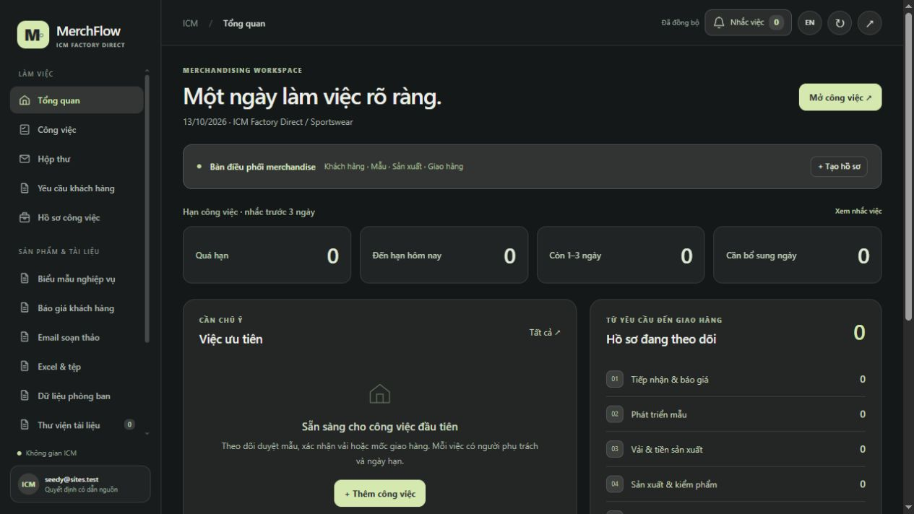

# MerchFlow

**Không gian làm việc cho merchandiser ngành may mặc / An apparel merchandising workspace.**

MerchFlow connects customer requests, styles and purchase orders with daily tasks, quotations, email drafts, department records and reviewed learning. The interface supports Vietnamese and English.

This repository is a clean public source snapshot. It contains **no customer PDFs, customer-derived training articles, mailbox messages, production database, OAuth credentials or previous private Git history**.



## Features and current status

| Area | Included in this source |
| --- | --- |
| Customers and workspaces | Buyer records, style/PO references, manufacturing stages, notes and source links |
| Daily work | Due dates, three-day reminders, completion archive, activity timeline and history |
| Intake forms | Inquiry, quotation, sample, material, production and quality templates |
| Quotations | Editable company/customer details, line items, currency, commercial terms and printable templates |
| Excel | Editable workbook templates, Excel export and storage by work area |
| Email | In-app drafting; direct Gmail OAuth adapter for reading and creating Gmail drafts after setup and consent |
| Other mailboxes | Outlook and domain-mail account records; provider adapters are **not implemented**. Google Workspace domain mail can use the Gmail adapter |
| Purchasing / Design | Manually maintained records, revisions, review history and Drive references |
| Google Drive | Destination and source links only; automatic Drive reading/writing is **not connected** |
| Knowledge | Evidence-linked draft articles, review and training workflows; the public library starts empty |
| Daily AI summary | Workflow contract and protected endpoints included; requires a separately configured scheduler and AI agent |

Creating a mailbox record does not grant access to that mailbox. Saving a schedule in the interface does not install an external scheduler. Mail drafts are not automatically sent. AI suggestions need human review before commercial commitments or production decisions.

## Quick start — local development

Requirements: Node.js 22.13 or later, npm, and a supported Cloudflare Workers development environment.

```sh
npm run install:ci
npm run build
```

Initialize a **new local database** by applying these two migrations once, in order:

```sh
node --import ./scripts/sites-env.mjs ./node_modules/wrangler/bin/wrangler.js d1 execute DB --local --config dist/server/wrangler.json --persist-to .wrangler/state --file drizzle/0000_greedy_proudstar.sql
node --import ./scripts/sites-env.mjs ./node_modules/wrangler/bin/wrangler.js d1 execute DB --local --config dist/server/wrangler.json --persist-to .wrangler/state --file drizzle/0001_flaky_nocturne.sql
npm run dev
```

Open `http://localhost:5173`. The portable development profile supplies a local mock identity. Keep this preview on your own machine; mock identity is not production authentication. The application starts with no customer records.

Copy `.dev.vars.example` to `.dev.vars` only if local environment values are needed. The example contains no credentials. Local data, build output and filled environment files are ignored by Git.

## Production deployment

The current deployment target is **ChatGPT Sites**, using Vinext/React, Cloudflare Workers, D1 and R2. GitHub is the source repository; **GitHub Pages cannot run this backend**, database or OAuth flow.

1. Provision a separate Site with an authenticated audience, D1 binding `DB` and R2 binding `BUCKET`.
2. Configure the Site-specific hosting metadata and trusted authentication boundary in your private deployment environment. This snapshot intentionally has no existing Site or connector IDs.
3. Apply the SQL migrations through the deployment platform before using the app. Back up existing data before any future schema migration.
4. Store credentials as deployment secrets. Configure your own HTTPS origin and Google callback.
5. Build and deploy through the platform, then verify ownership isolation, OAuth consent, file access and scheduler authentication before adding business data.

The application trusts `oai-authenticated-user-*` headers supplied by the Sites gateway. **Do not expose this Worker directly to the Internet while accepting caller-provided identity headers.** A different hosting platform needs its own verified authentication/session layer, header stripping, sign-in routes and authorization checks. That deployment adapter is not included.

## Direct Gmail setup

The OAuth adapter is included; it remains unavailable until the deployment has all required values:

| Server setting | Purpose |
| --- | --- |
| `GOOGLE_CLIENT_ID` | Your Google web application client ID |
| `GOOGLE_CLIENT_SECRET` | Its server-side client secret |
| `GOOGLE_TOKEN_ENCRYPTION_KEY` | A cryptographically random 32-byte key encoded as base64url |
| `GOOGLE_REDIRECT_URI` | `https://YOUR-APP-ORIGIN/api/google/callback`, registered exactly with Google |
| `GMAIL_CONNECTOR_ID` | Optional Sites-native connector ID; not needed for direct Google OAuth |
| `DAILY_WORKER_SECRET` | A deployment-specific random secret of at least 32 characters for unattended daily API calls |

Enable Gmail API for your Google project and configure its OAuth audience, consent and allowed users according to Google's requirements. Reading asks for `gmail.readonly`; creating Gmail drafts requests additional `gmail.compose` access. The app exposes draft creation, not a send-email endpoint. Employees connect their own accounts; managers are not automatically granted mailbox access.

Tokens are stored encrypted in the deployment database. Keep the encryption key stable and protect backups; changing or losing it requires users to reconnect. Do not place secrets in frontend scripts, public files, GitHub issues, screenshots or commits.

## Daily summaries and tasks

`public/daily-workflow.json` is an **instruction template**, not an installed automation. Replace its example Site ID and origin in a private deployment. Configure one authorized agent/scheduler, normally at 08:00 in `Asia/Bangkok` (Vietnam time), and give it only that deployment's access.

Unattended requests to `/api/daily-worker` and `/api/daily-gmail` require `Authorization: Bearer <DAILY_WORKER_SECRET>` as well as the host's access controls. Without a configured secret, anonymous service calls fail closed. Never put the secret into the public workflow JSON. Signed-in calls remain scoped to the configured schedule owner.

The workflow reads a rolling 24-hour window for tasks, retains original message evidence, deduplicates by mailbox/message ID and preserves human edits and completed tasks. It produces editable summaries and drafts, with explicit incomplete-coverage reporting. The repository does not bundle an AI model or provision paid services.

## Data and source documents

- Application records and audit history live in D1; uploaded work files use R2.
- `lib/corpus.json` and `public/knowledge.json` are intentionally empty.
- Original deployment PDFs and page images are excluded from this repository.
- Files put under `public/` become static web assets. Never use it for employee-specific or confidential documents. Add private documents through authenticated application storage or implement an authenticated document service first.
- A Drive folder URL is a destination preference, not proof that a backup or sync exists.
- Use a private deployment repository for confidential configuration and customer-specific customizations. Review each future public commit for business data and secrets.

## Structure

```text
app/                 Application entry and authenticated API routes
lib/                 Mailbox, OAuth, operations and validation logic
public/              Bilingual UI, templates and empty knowledge library
db/ + drizzle/       Database schema and migrations
build/ + scripts/    Sites/Vinext build and local development support
.openai/hosting.json Binding names only; no production identity
```

## Hướng dẫn ngắn bằng tiếng Việt

1. Bản này công khai mã nguồn, không kèm dữ liệu kinh doanh đang sử dụng.
2. Cài môi trường, tạo cơ sở dữ liệu trống và chạy theo phần Quick start.
3. Để dùng thật, triển khai bản riêng có đăng nhập; cấu hình Google một lần rồi từng nhân viên tự kết nối Gmail.
4. Lịch AI hằng ngày, Outlook và đồng bộ Drive cần cấu hình hoặc phát triển bổ sung như bảng trạng thái phía trên.
5. Tạo khách hàng → hồ sơ → biểu mẫu → công việc → kết quả → bài học được duyệt để lưu kinh nghiệm của đội ngũ.

## License

No project license has been selected for this snapshot. Third-party notices are preserved in `build/sites-vite-plugin.LICENSE`, `vendor/shadcn-tailwind-4.13.0.LICENSE.md` and `public/vendor/exceljs-LICENSE.txt`. Dependency packages retain their respective licenses.
